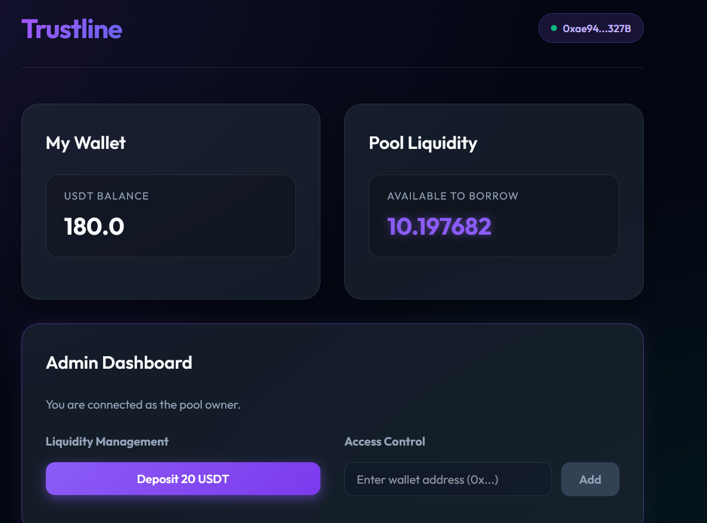
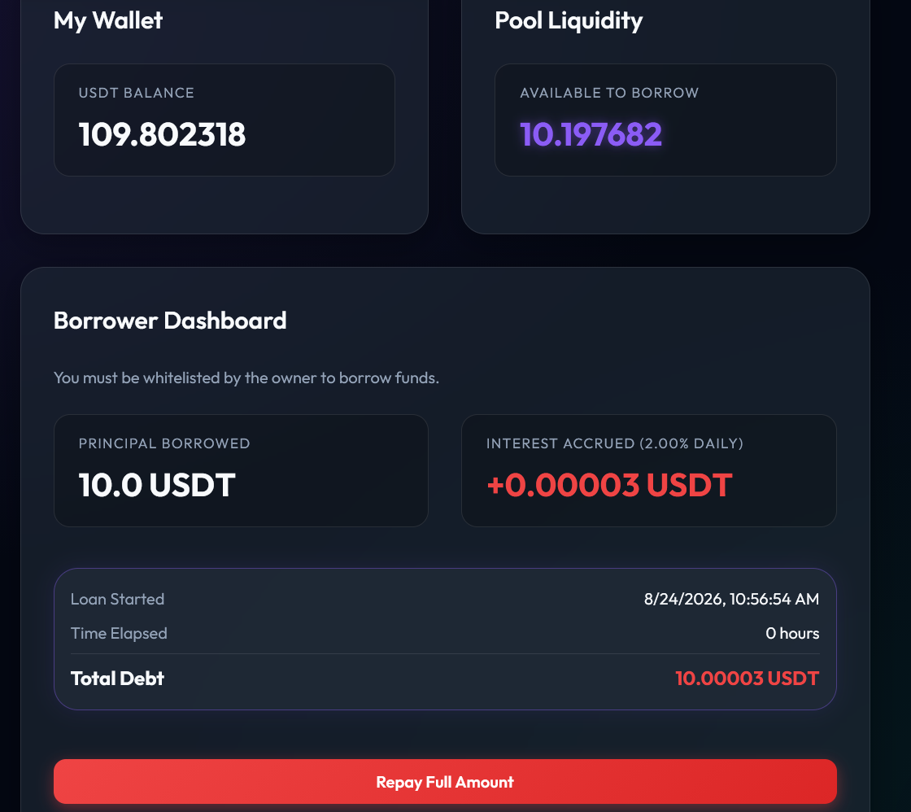

# Trustline Lending Pool

Trustline is an automated smart contract lending pool for managing small, short-term loans among a closed group of friends. 

## UI Preview

Check out the premium frontend built for this protocol, featuring role-based dashboards with real-time interest tracking and liquidity management:

<div align="center">
  
  
</div>
<br/>

## Problem It Solves
Tracking who owes what, calculating interest, and managing repayments manually via bank transfers is tedious and error-prone. Trustline automates all accounting, enforces strict borrowing limits (you can't take a new loan if you already have an active one), and calculates daily interest autonomously.

## Features
- **Whitelist Management**: Only pre-approved friend wallets can participate in borrowing.
- **Dynamic Liquidity Management & Headroom Capacity**: The pool owner can deposit arbitrary amounts up to the 20 USDT pool cap, with a one-click "Max" fill option.
- **Automated Real-Time Interest**: 2% daily simple interest calculation pro-rated per second, computed autonomously and displayed in real-time.
- **Single-Transaction Repayment**: Borrowers repay the full principal + accrued interest in a single transaction (with a 5-minute interest buffer to prevent repayment reverts while mining).
- **Dual-Network Ready**: The same frontend codebase seamlessly runs on both **Base Sepolia (testnet)** and **Base Mainnet** via environment variables.
- **Uncollateralized**: Relies on real-world social trust, rather than collateral.

## Smart Contracts & Networks
The core smart contract logic is implemented in Solidity and deployed to **Base** (EVM L2) to ensure that transaction fees do not exceed micro-loan amounts:
- **Base Sepolia (Testnet)**
- **Base Mainnet (Production)**

## Project Structure
- `contracts/`: Solidity smart contracts (`TrustlineLendingPool.sol`, `MockUSDT.sol`).
- `frontend/`: React + Vite frontend application with glassmorphic UI and unit tests.
- `scripts/`: Deployment, interaction, simulation, and on-chain diagnostic scripts.
- `test/`: Hardhat/Chai test suite for smart contracts.
- `docs/`: Project documentation including architecture, product strategy, and task handoffs.

## Developer Setup

### Prerequisites
- Node.js >= 18
- npm

---

### Smart Contracts (Root Directory)

1. **Install dependencies**:
   ```bash
   npm install
   ```

2. **Compile smart contracts**:
   ```bash
   npx hardhat compile
   ```

3. **Run contract test suite**:
   ```bash
   npx hardhat test
   ```

4. **Simulate loan lifecycle**:
   Simulate end-to-end depositing, borrowing, time-travel, and repayment locally:
   ```bash
   npx hardhat run scripts/simulate.js
   ```

5. **Diagnostic CLI (Check Active Loan)**:
   Query active loan status directly from the blockchain for a specific borrower:
   ```bash
   BORROWER="0x..." npx hardhat run scripts/checkLoan.js --network base_sepolia
   ```

---

### Frontend Setup (`frontend/` Directory)

1. **Install dependencies**:
   ```bash
   cd frontend
   npm install
   ```

2. **Configure Environment Variables**:
   Copy `.env.example` to `.env`:
   ```bash
   cp .env.example .env
   ```
   Set the deployed contract addresses:
   ```env
   VITE_POOL_ADDRESS="0x..."
   VITE_USDT_ADDRESS="0x..."
   ```

3. **Start local development server**:
   ```bash
   npm run dev
   ```

4. **Lint frontend code**:
   ```bash
   npm run lint
   ```

5. **Run frontend unit tests**:
   ```bash
   node --test src/utils.test.js
   ```
